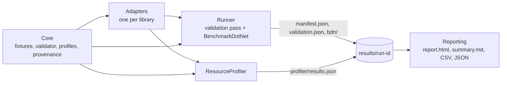

# Architecture

The plan's logical layout (separate Generation, Manipulation, HtmlToPdf and Scalability benchmark projects) is
consolidated into fewer projects to avoid duplicated infrastructure: BenchmarkDotNet scenarios share one Runner project,
organized by category, and process-level scalability lives in the ResourceProfiler.

## Projects

| Project | Responsibility |
|---|---|
| `UnlimitedPDF.Benchmarks.Core` | Deterministic fixtures (`Fixtures/`), the independent validator (`Validation/`), execution profiles (`Profiles/`), run provenance (`Provenance/`), the library catalogue and statistics helpers. |
| `UnlimitedPDF.Benchmarks.Adapters` | `Capabilities.cs` defines narrow capability interfaces. `UnlimitedPdf/`, `PdfSharp/`, `MigraDoc/`, `PdfPig/` and `SkiaSharp/` each contain one adapter using only that library's public API. |
| `UnlimitedPDF.Benchmarks.Runner` | `Benchmarks/` holds one BenchmarkDotNet class per scenario. `Infrastructure/` holds the scenario base class, expectations, the validation pass, the validated-case filter and the BenchmarkDotNet configuration. |
| `UnlimitedPDF.Benchmarks.ResourceProfiler` | Orchestrates child processes (`worker` command) for cold start, sequential, concurrent and long-running suites, sampling process resources on a background thread. |
| `UnlimitedPDF.Benchmarks.Reporting` | Joins validation records, BenchmarkDotNet JSON and profiler results, computes ratios against a passed baseline and writes the reports. |

## Capability interfaces

`IEmptyDocumentGenerator`, `ITextDocumentGenerator`, `IStandardFontTextGenerator`, `IRichTextGenerator`,
`IImageDocumentGenerator`, `IVectorGraphicsGenerator`, `IMixedContentGenerator`, `ITableGenerator`,
`IHeaderFooterGenerator`, `IBusinessDocumentGenerator`, `IMultilingualGenerator` (with `Supports(Language)`), `IPdfMerger`,
`IPdfSplitter`, `IPageExtractor`, `IPageRemover` and `IHtmlToPdfConverter`. An adapter implements only what its library
supports, so support is a compile-time fact rather than a runtime emulation. Benchmark methods call the concrete sealed
adapters directly; the interfaces are used by the profiler and tests.

## Case lifecycle

1. **Discovery**: the Runner enumerates every scenario class, its `[ParamsSource]` values for the selected profile and its
   library methods. A case id is `Type.Library(Param=Value, ...)`.
2. **Validation pass** (`validate`): each case is prepared, executed once with a timeout and validated. The status is
   recorded in `validation.json` as Passed, FailedValidation, Unsupported, ExecutionFailed, TimedOut or NotExecuted.
   The first case per scenario and library keeps its PDF and a PDFium render in `samples/`.
3. **Measurement** (`bench`, a fresh process): BenchmarkDotNet runs with `ValidatedCaseFilter`, so only Passed cases are
   measured, with MemoryDiagnoser and Markdown, CSV, HTML and full JSON exporters.
4. **Profiling**: the ResourceProfiler starts one child process per measurement.
5. **Reporting**: the Reporting tool reads only the raw files, so reports can be regenerated at any time.

## Adding a library

Add the package to `Directory.Packages.props` after a licence and vulnerability review, add its id to `LibraryIds` and
`LibraryCatalog`, implement an adapter for the capabilities it supports, add a `[Benchmark]` method named by its id to
each scenario it supports and a `[NotApplicable]` attribute with a reason to the others. The integration test
`EveryScenarioDeclaresEachLibraryAsMeasuredOrNotApplicable` enforces this.
